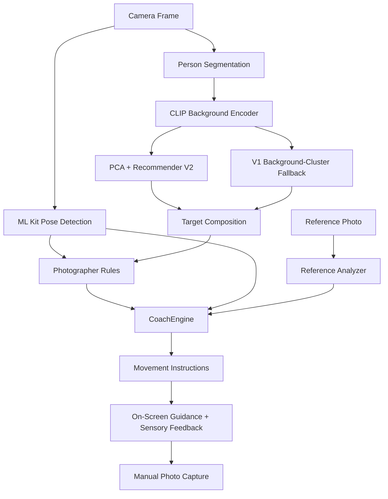

# GUDORY (구도리)

> **사진 감각, 빌려드릴게요.** GUDORY lends your sense of a good shot to whoever is holding your phone. It guides them with simple instructions, proximity beeps, and vibration.

InThon 2026 · Theme: **감각 (Sense)** · Team Gaslighteam

- 📱 **APK Download:** Coming soon
- ▶️ **Demo Video:** Coming soon

## Problem

When you hand your phone to a friend or stranger, they may not know how you want your photo to look.

Even with camera grids and composition guides, it can be difficult to know what to adjust, which direction to move, or how far to move.

## Solution

**GUDORY turns photographic composition into simple, actionable instructions.**

It analyzes the camera frame, recommends a target composition, and compares the live shot against that target.

The photographer receives one instruction at a time, such as:

- "두 걸음 뒤로 가 주세요" — Take two steps back.
- "폰을 조금 아래로 내려 주세요" — Lower the phone slightly.

As the composition improves, proximity beeps become faster. When the shot is aligned, GUDORY provides a sound, vibration, and visual confirmation.

The photographer then presses the shutter manually.

## Features

### 1. Recommendation Mode (추천)

GUDORY analyzes the background using CLIP and recommends a composition through lightweight machine learning.

- Predicts the person's framing, horizontal placement, eye height, and size.
- Offers five levels, from person-centered to background-centered compositions.
- Applies photographer rules to refine person-centered recommendations, including headroom, joint boundaries, and looking direction.
- Falls back to the original background-cluster recommender when V2 is unavailable.

### 2. Custom Mode (맞춤)

Use a reference photograph as the target composition.

- Import portrait or landscape reference images.
- Save multiple references and switch between them.
- Keep references across shots until manually removed.

### 3. Real-Time Photography Coaching

GUDORY compares the live camera view with the target composition and provides one instruction at a time.

- Camera orientation, distance, horizontal position, and height guidance.
- Direction arrows and concise on-screen instructions.
- Proximity beeps, vibration, and alignment feedback.
- Instruction stabilization to prevent rapid changes.
- Manual shutter capture when the desired composition is reached.

Coaching runs on the rear camera. The front camera remains available for ordinary photography.

### 4. Multilingual Guidance

Photography instructions are available in:

- Korean (한국어)
- English
- Japanese (日本語)

A built-in interactive tutorial explains the camera controls.

### 5. Camera Experience

- Portrait and landscape photography
- Continuous zoom and camera controls
- Grid lines and composition aids
- Full-resolution photo capture
- Saved photographs matching the visible camera preview
- Automatic saving to the GUDORY album

## How the AI Works

GUDORY combines pretrained computer vision models with lightweight composition prediction.

1. **Person Detection and Segmentation:** Google ML Kit detects body landmarks and separates the person from the background.
2. **CLIP:** Converts the background into a 512-dimensional feature vector.
3. **PCA:** Reduces those 512 features to 32 dimensions.
4. **Regression and Classification:** Predict framing, horizontal offset, and eye height using the compressed background features and shooting preferences. Person size is selected from a learned statistical table.
5. **Composition Coaching:** The target composition is refined when applicable and passed to the coaching engine, which generates real-time movement instructions.

Recommender V2 was trained on **694 usable human photographs** from the Composition Assessment DataBase (CADB), with higher-rated compositions receiving greater weight.

Instead of training a large neural network from scratch, GUDORY uses pretrained CLIP features and small linear models.

All live image analysis and composition inference run **on-device**. Camera frames are not uploaded for recommendation processing.

### Recommendation Model Evaluation

In an evaluation using 500 Open Images photographs not used to train V2:

| Metric | V1 | V2 |
|---|---:|---:|
| Horizontal offset MAE ↓ | 0.104 | **0.080** |
| Eye-height MAE ↓ | 0.100 | **0.097** |
| Framing accuracy ↑ | **63.2%** | 62.4% |

V2 improved horizontal placement prediction and reduced the previous tendency to recommend centered compositions.

These results measure agreement with observed photographic compositions, not a proven improvement in aesthetic quality. The evaluation photographs were also part of V1's training data.

For details, see:

- [Recommender V2 Evaluation](tools/report_v2.md)
- [CADB Dataset and Research](docs/cadb.md)

## Architecture



Photographer rules apply to person-centered recommendation levels. Custom mode uses its reference target without those rules.

Core module interfaces are defined in `app/lib/core/contracts.dart`.

### Project Structure

```text
app/       Flutter application
  lib/
    core/                 Shared models and contracts
    features/
      camera/             Camera UI and capture
      coach/              Pose analysis and coaching
      scene/              Composition recommendation
      feedback/           Audio and haptic feedback
      settings/           Application preferences
      tutorial/           Interactive camera tutorial

tools/     Python data processing and model training
data/      Local training photographs (not committed)
docs/      Technical documentation and project resources
```

## Tech Stack

| Component | Technology |
|---|---|
| Mobile application | Flutter / Dart |
| Camera | Flutter Camera |
| Pose detection | Google ML Kit Pose Detection |
| Person segmentation | Google ML Kit Selfie Segmentation |
| Background understanding | CLIP ViT-B/32 |
| Model inference | ONNX Runtime |
| Feature reduction | PCA |
| Composition prediction | Logistic Regression, Ridge Regression |
| Training pipeline | Python, NumPy, scikit-learn, MediaPipe |
| Sensory feedback | Audio and vibration |
| Target platform | Android |

The application uses Flutter **3.44.8** and Dart **3.12.2**.

### Model Assets

| Asset | Purpose | Size |
|---|---|---:|
| `recommend.json` | Original CLIP background-cluster recommendations and fallbacks | ~108 KB |
| `recommend_v2.json` | PCA, trained linear models, and composition statistics | ~162 KB |
| `vision_q8.onnx` | Quantized CLIP vision encoder | ~89 MB |

The CLIP model file is excluded from Git and must be downloaded separately.

## Getting Started

### Requirements

- Flutter 3.44.8
- Dart 3.12.2
- Android device (minSdk 24)
- Python 3

### Installation

Clone the repository:

```bash
git clone https://github.com/Gaslighteam/GUDORY.git
cd GUDORY
```

Download the required CLIP model:

```bash
python tools/fetch_models.py
```

Install Flutter dependencies and run the application:

```bash
cd app
flutter pub get
flutter run
```

To build a debug APK:

```bash
flutter build apk --debug
```

The APK will be generated at:

`app/build/app/outputs/flutter-apk/app-debug.apk`

If the CLIP model is unavailable, the application uses its predefined composition fallbacks.

## Training Data and Credits

GUDORY uses multiple datasets and pretrained models.

- **CADB (Composition Assessment DataBase):** Expert-rated photographs used to train Recommender V2.
- **Open Images V7:** Supplementary one-person photographs used for the original recommendation system.
- **Team and Friends' Photographs:** Photographs collected with permission for the original recommendation dataset.
- **CLIP ViT-B/32:** Pretrained image encoder by OpenAI, with an ONNX model from [Xenova](https://huggingface.co/Xenova/clip-vit-base-patch32).
- **Google ML Kit:** On-device pose detection and person segmentation.
- **MediaPipe:** Used for offline pose analysis.

Original training photographs, personal image data, and per-photo embeddings are not included in the repository or application assets.

### Dataset and Model Licenses

| Resource | License / Attribution |
|---|---|
| CADB code and annotations | [MIT](https://github.com/bcmi/Image-Composition-Assessment-Dataset-CADB/blob/main/LICENSE); source images from AADB/Flickr retain their respective rights |
| Open Images V7 | [CC BY 4.0 annotations](https://creativecommons.org/licenses/by/4.0/); source images listed under CC BY 2.0 |
| Team and friends' photographs | Permission for this project |
| CLIP ViT-B/32 | [MIT](https://github.com/openai/CLIP/blob/main/LICENSE) |
| MediaPipe and associated offline models | Apache 2.0 |
| Google ML Kit | [ML Kit Terms](https://developers.google.com/ml-kit/terms) |

Source photographs are retained locally for training and evaluation. Only learned model parameters and aggregated composition data are distributed with the application.

Additional license information is available in the application settings.

## Team Gaslighteam

| Member | Role |
|---|---|
| Kim Taeho | Team Lead · Camera, UI, Integration, Feedback |
| Seojun | Composition Recommendation · CLIP · Data Pipeline |
| Han Eungyu | Pose Detection · Coaching Engine · Reference Analysis |
| Kim Bomin | Training Data · Research · Documentation · QA |

---

**GUDORY — 사진 감각, 빌려드릴게요.**
