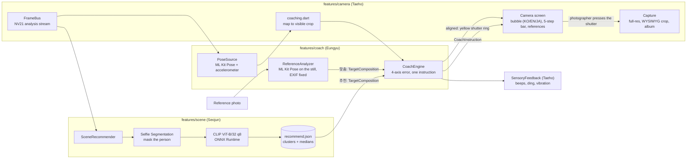

# GUDORY (구도리)

> **사진 감각, 빌려드릴게요.** GUDORY lends your **sense (감각)** of a good shot to whoever is holding your phone. It gives them one plain sentence at a time, plus beeps and a vibration they can follow by ear and by hand.

InThon 2026 · Theme "감각 (sense)" · Team Gaslighteam

- 📱 **APK download:** (GitHub Releases link, filled before submission)
- ▶️ **Demo video:** (YouTube link, filled before submission)

## Problem
When you hand your phone to a friend or a stranger, the problem isn't their skill. They just don't share your sense of the shot. You get 30 seconds of their time, and a grid or a translucent overlay doesn't tell them what to fix first, or by how much.

## Solution
GUDORY measures how far the live frame is from a target composition on four axes: level, distance, horizontal position and height. It then shows **only the biggest correction**, in words the body can act on: "두 걸음 뒤로 가 주세요" (take two steps back), "폰을 주먹 하나만큼 아래로 내려 주세요" (lower the phone by one fist). Beeps speed up as the frame gets closer. When it lines up, a ding, a vibration and a yellow ring around the shutter tell the photographer to press it. The photographer always takes the shot by hand.

The target comes from one of two modes:
- **추천 (recommend):** the app reads the background and borrows the composition of similar, well-shot photos of one person.
- **맞춤 (custom):** the target is a reference photo you choose.

## Features
1. **추천 모드 (recommend)**
   - The on-device CLIP model looks at the background only (the person is masked out) and matches it against background clusters built from real one-person photos.
   - A **5-step bar** chooses from 인물 중심 (1, the person large) to 배경 중심 (5, more background). Each level has its own framing (chest-up, waist-up, knee-up or full body), position and size.
2. **맞춤 모드 (custom)**
   - Load one or more reference photos, portrait or landscape. The active one (yellow border) becomes the target.
   - References stay across shots until you clear them with X.
3. **Real-time coaching without voice**
   - One instruction bubble with a direction arrow.
   - **Proximity beeps** that get faster as the error shrinks.
   - When aligned: a **ding, a vibration and a yellow shutter ring**, and the bubble says "좋아요! 지금 셔터를 눌러 주세요" (press the shutter now). There is no auto shutter: the photographer presses it.
   - Instructions use hysteresis and a minimum hold time, so they don't flicker.
   - Coaching runs on the **back camera**, because someone else is taking the photo. The flip button switches to the front camera as a plain camera, with no coaching or recommendation (flash, zoom, `?` and language stay).
4. **Instruction language and how-to (top right: `?` · language · flash)**
   - The language button (`KO` / `EN` / `JA`) switches the on-screen instructions to 한국어, English or 日本語. Use it when you ask a foreigner to take the photo.
   - `?` opens a short how-to. It also opens automatically on the first launch.
5. **Portrait and landscape:** the accelerometer decides how the phone is held, and the icons and bubble rotate in place. If the target's orientation differs, the first instruction is "폰을 가로로 돌려 주세요" (turn the phone sideways).
6. **WYSIWYG saving:** the photo is taken at full sensor resolution and cropped to exactly what the preview showed. Landscape shots are rotated on save. Photos go to the GUDORY album, with no result screen in between.

## Architecture


Module contracts (`FrameBus`, `PoseSource`, `CoachEngine`, `ReferenceAnalyzer`, `Recommender`, `FeedbackService`) live in `app/lib/core/contracts.dart`. They are documented in [AGENTS.md](AGENTS.md) §4.

```
app/     Flutter app (Android): features/camera · feedback (Taeho) · coach (Eungyu) · scene (Seojun)
tools/   Python pipeline: one-person photos → app/assets/recommend.json
data/    Training photos (never committed; see data/README.md)
docs/    Plan and concept documents
```

## AI used
Everything runs **on the phone**. No photo, frame or embedding leaves the device.

| What | Model | Where |
|---|---|---|
| Body landmarks (live and reference) | Google ML Kit Pose Detection | on device |
| Person mask, so CLIP compares backgrounds only | Google ML Kit Selfie Segmentation | on device |
| Background embedding | CLIP ViT-B/32 vision encoder, int8 (q8) ONNX, ~89 MB, ONNX Runtime | on device |
| Target compositions | `recommend.json` (24 KB), built offline by `tools/build_assets.py` | bundled asset |

`recommend.json` was built from **5,603 photos**, of which 3,233 passed the one-person, pose and segmentation checks. It holds **103 background clusters** (43 portrait, 60 landscape), each with median compositions per level and framing, plus fallbacks per orientation and level. It contains only aggregated statistics: no photo IDs, images or per-photo numbers. If CLIP is unavailable, the app falls back to the level medians and keeps coaching.

## Data and credits
- **Training photos:** photos taken by team members, and by friends who gave permission (weighted 3×). These are supplemented by **Open Images V7** one-person photos (Flickr, CC BY 2.0), weighted 1×. Originals stay on our PCs, per [data/README.md](data/README.md) and the dataset terms. Only the aggregated `recommend.json` ships.
- **Recommender v2 training data:** the `human` photos of **CADB** (Composition Assessment DataBase; Zhang, Niu & Zhang, BMVC 2021; [code and annotations](https://github.com/bcmi/Image-Composition-Assessment-Dataset-CADB), MIT). Its images come from AADB (Flickr). They were used only on our PCs for training. `recommend_v2.json` holds only the learned weights and aggregates ([docs/cadb.md](docs/cadb.md)).
- **CLIP ViT-B/32:** OpenAI, MIT License. ONNX export: [Xenova/clip-vit-base-patch32](https://huggingface.co/Xenova/clip-vit-base-patch32).
- **Google ML Kit:** Pose Detection and Selfie Segmentation. The data pipeline also uses MediaPipe Pose Landmarker, EfficientDet-Lite0 and Selfie Segmenter.
- **Beeps and sounds:** generated by the team.
- **Demo and reference photos:** taken by team members.

## Run locally
Requirements: Flutter 3.44.8, a real Android device (minSdk 24) and Python 3.

```bash
# 1) Fetch the CLIP model (not in the repo) into app/assets/clip/vision_q8.onnx
python tools/fetch_models.py
# 2) Run the app
cd app
flutter pub get
flutter run
```

Without the model file the app still runs, but 추천 mode falls back to the level medians. To rebuild `recommend.json` from your own photos, see [tools/README.md](tools/README.md).

## Team
| Name | Role |
|---|---|
| Kim Taeho | Lead · camera screen, capture, feedback, instruction languages · integration and release |
| Seojun | 추천 mode: CLIP recommender on device · data pipeline (`tools/`) |
| Han Eungyu | Coaching engine · pose source · reference analyzer · presenter |
| Kim Bomin | Training data · data rules and docs · slides · QA |
